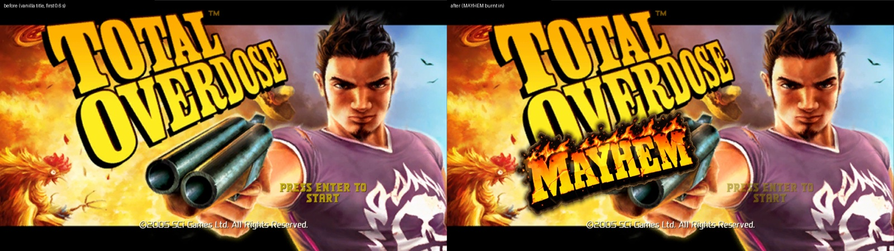
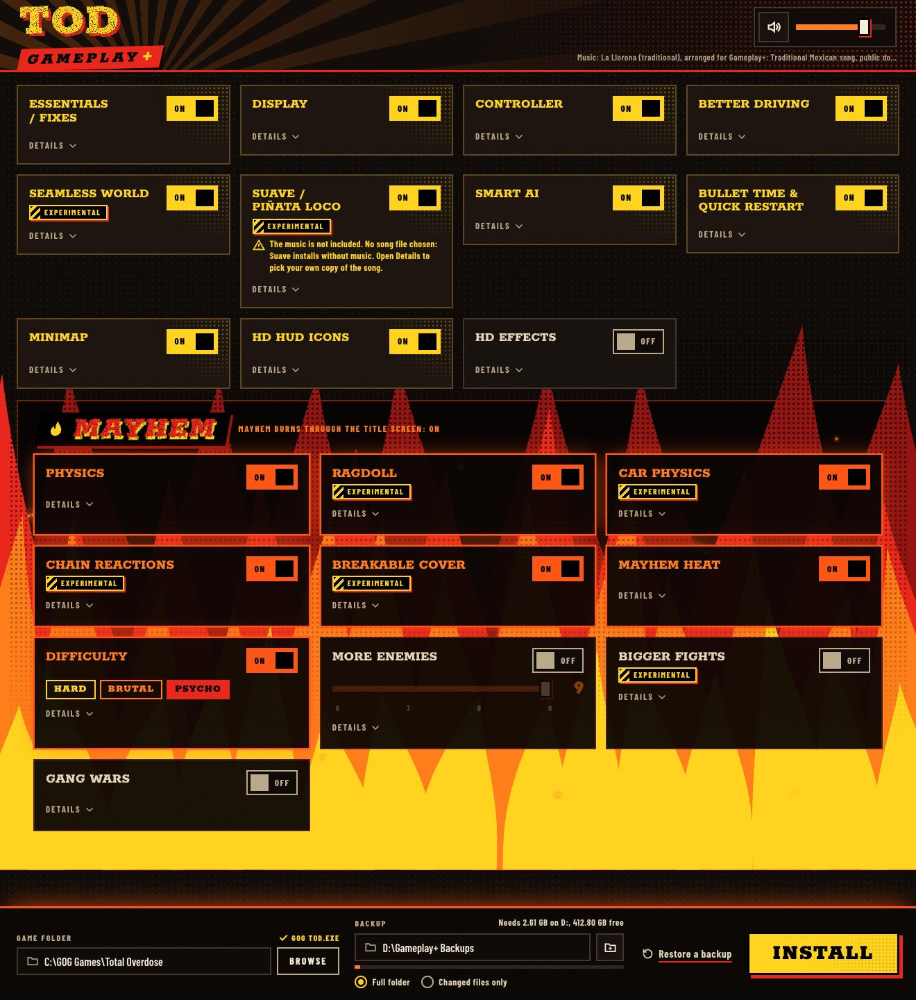
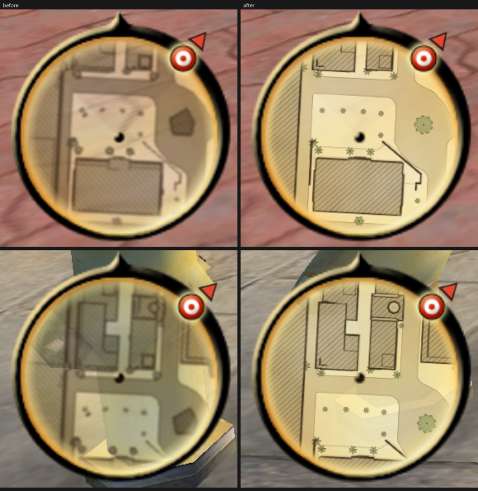
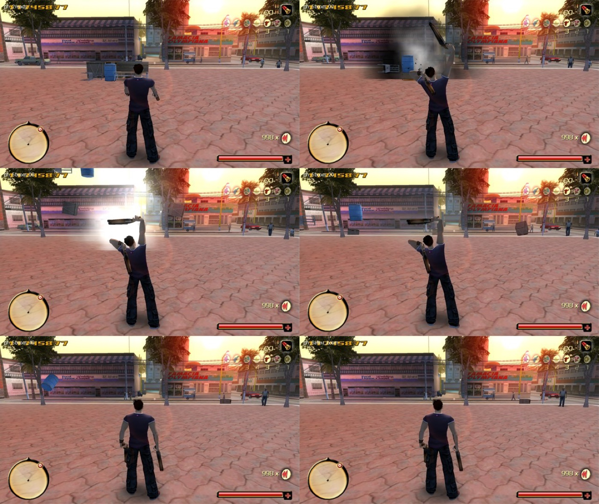
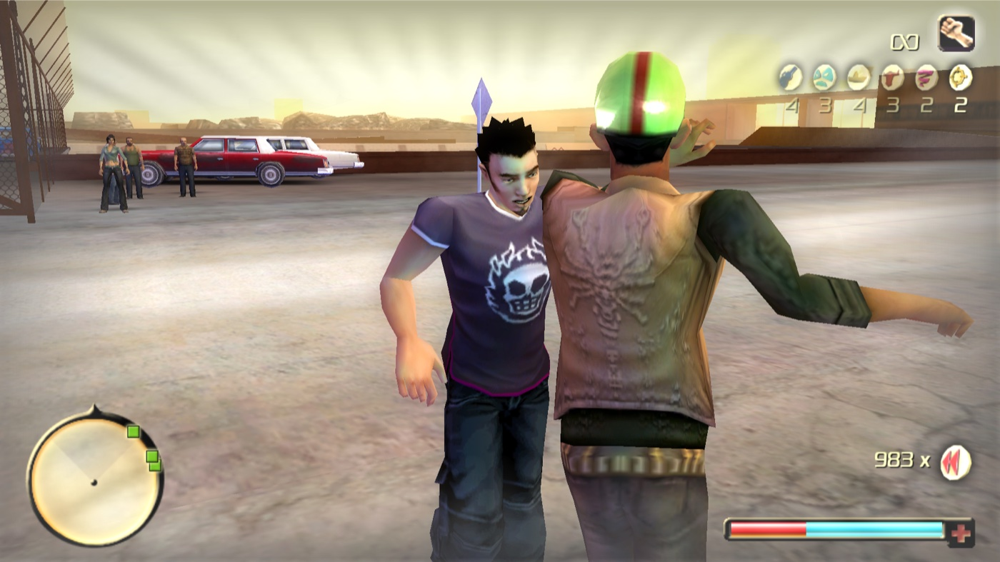

# TOD Mayhem Edition (Gameplay+)

A fan-made gameplay overhaul for **Total Overdose** (2005, GOG version, Windows). It adds real physics and ragdolls,
a heat system, harder difficulty levels, a new HUD, controller support, crash and display fixes, and a visual
installer that backs up your game before it touches anything.

## Download and install

1. Get **TOD Mayhem Installer.7z** from the
   [latest release](https://github.com/MikeTheSavage/tod-mayhem-edition/releases/latest) and unpack it.
2. Quit the game.
3. Run `TOD Mayhem Installer.exe`. It opens its own window and only talks to your own PC.
   Windows may say the publisher is unknown, because the exe is not code-signed: choose **More info**, then
   **Run anyway**.
4. Pick the game folder (the one with `TOD.exe`), switch on the features you want, choose where the backup goes
   (another drive is best) and press **INSTALL**.

You need Windows 10 or 11, Total Overdose from GOG, and free space for a full backup of the game folder (about
1.5 GB). The DLL features only run on the GOG `TOD.exe`.

### Undo

Press **Restore a backup** at the bottom of the installer, pick the backup it made before your first install and
press **RESTORE**. That puts the game folder back exactly as it was. You can also switch every card off and install
again.

### The Suave song

The Suave dance move plays to four short clips of "Suavemente" by Elvis Crespo. That song is commercial and is not
included. In the installer's Suave card, press **Choose file** and pick your own copy of the studio version (about
4:28; mp3, wav, flac, ogg and similar).

## Features

| Group | What you get |
|---|---|
| Essentials and fixes | Fixes for two engine crashes, frame-rate fixes for timers, pickups and mouse turning, a hang watchdog |
| Display | A real 16:9 picture with the HUD at the screen edges, unstretched menus, and an in-game resolution menu with windowed, borderless and fullscreen modes |
| Controller | Xbox and PlayStation pads through the game's own console controls, with button prompts and rumble |
| Better driving | Reworked driving feel and camera distance |
| Bullet time and quick restart | Manual bullet time with a meter, dive slow motion off, FOV, key rebinding, quick restart |
| Seamless world (experimental) | Walk across a map border without a loading screen |
| Smart AI | Enemies take roles, stagger their reactions, take turns closing in, and can break and run |
| Suave (experimental) | A new loco move: a salsa with an enemy, a clapping ring, dynamite and a dive |
| Minimap and markers | A sharp tile map inside the radar and markers over objectives |
| HD effects | Ambient occlusion, per-pixel lighting, shadows, reflections, particles and water on the original game |
| MAYHEM: physics | Box3D physics: props fall, tumble and fly from bullets and blasts; cars shove props and wrecks flip |
| MAYHEM: ragdolls | Hit enemies stagger; dead ones go limp and get thrown by explosions |
| MAYHEM: chain reactions | Explosions set off nearby explosives and cars; cover breaks into debris |
| MAYHEM: heat | Chaos fills a 5-level wanted meter on the radar; more heat brings more enemies |
| MAYHEM: difficulty | EASY to PSYCHO in the game's own settings; BRUTAL brings more enemies, PSYCHO elites use loco moves against you |
| MAYHEM: bigger fights and gang wars | More enemies per fight, police cars with gunmen at high heat, rival gangs fighting each other |

Every feature has its own guide in [docs/mods](docs/mods/README.md).

| | |
|---|---|
|  |  |

A short showcase video is in [showcase/](showcase/).

## How it works

- **A proxy DLL.** The game loads `dsound.dll` from its own folder. The proxy forwards the real DirectSound calls
  and loads `TODGameplay.dll`, which checks that `TOD.exe` is the exact GOG build, then patches the code sites listed
  in [dll/src/sites.h](dll/src/sites.h). Settings live in `TODGameplay.ini`. Physics and ragdolls run in a second
  DLL, `TODPhysics.dll`, built on [Box3D](third_party/box3d).
- **A data zip built from your game.** [data/](data/) reads the game's own archives (read only) and writes
  `todgameplay_data.zip` with the changed values. The game loads it through one extra line in `configpc.txt`.
- **An installer.** [installer/](installer/) is a small local web app (Python backend, HTML/CSS/JS page) that makes
  the backup, builds the data, copies the DLLs and writes the ini. It ships packed into one exe.

[docs/mods/architecture.md](docs/mods/architecture.md) explains how the pieces fit together.
[dll/README.md](dll/README.md) and [dll/HOOKS.md](dll/HOOKS.md) document the loader and every hook.

## Building from source

You need Windows, Python 3.12 and Visual Studio 2026 with the x86 C++ toolset (v145).

- **DLLs:** run `dll\build.bat`. It builds the loader, the gameplay and physics DLLs, runs the unit and host tests
  in [tests/dll](tests/dll), and copies the results to `dist\`.
- **Data builder tests:** `python -m unittest` in [tests/data](tests/data).
- **Installer from source:** double-click `Gameplay Plus Installer.cmd`.
- **Installer exe:** in a separate Python environment with `soundfile`, `numpy` and `pyinstaller`, run
  `installer\pack_exe.cmd` from the repo root (see [installer/README.md](installer/README.md)).

Prebuilt binaries of the current version are in [dist/](dist/).

## Repository layout

| Folder | Contents |
|---|---|
| `dll/` | Loader and gameplay DLL source, build script, hook reference |
| `data/` | Data zip builder and its option catalogue |
| `installer/` | The visual installer (backend, web page, music, tests) |
| `dist/` | Prebuilt DLLs, ini and textures the installer ships |
| `physics/`, `ragdoll/`, `mayhem/`, `mayhem_heat/`, `psycho/`, `gang_wars/`, `bigger_fights/`, ... | One folder per feature: its code, tools and notes |
| `docs/mods/` | One guide per feature |
| `tests/` | Unit and host tests for the DLL and the data builder |
| `third_party/` | Box3D and the patches applied to it |

## Credits and licences

The project's own code is licensed under the [GNU GPL v3](LICENSE).

Third-party parts keep their own licences:

- [Box3D](third_party/box3d) physics engine: MIT ([licence](third_party/box3d/LICENSE)).
- GeneralUser GS SoundFont by S. Christian Collins, used to render the installer music
  ([licence](installer/music_src/licenses/GeneralUser-GS_LICENSE.txt)). The music is "La Llorona", a traditional
  Mexican song in the public domain, in this project's own arrangement.
- Installer fonts Barlow Condensed, Barlow Semi Condensed and Rokkitt: SIL Open Font Licence 1.1
  ([OFL.txt](installer/web/fonts/OFL.txt)).
- Poly Haven CC0 textures in the Suave trainer ([suave/trainer/public/env](suave/trainer/public/env)).
- The installer exe bundles Python 3.12 (PSF), PyInstaller (GPL 2 with bootloader exception), python-soundfile
  (BSD), libsndfile (LGPL 2.1), NumPy (BSD), cffi (MIT) and pycparser (BSD). Their licence texts ship inside the
  release archive.
