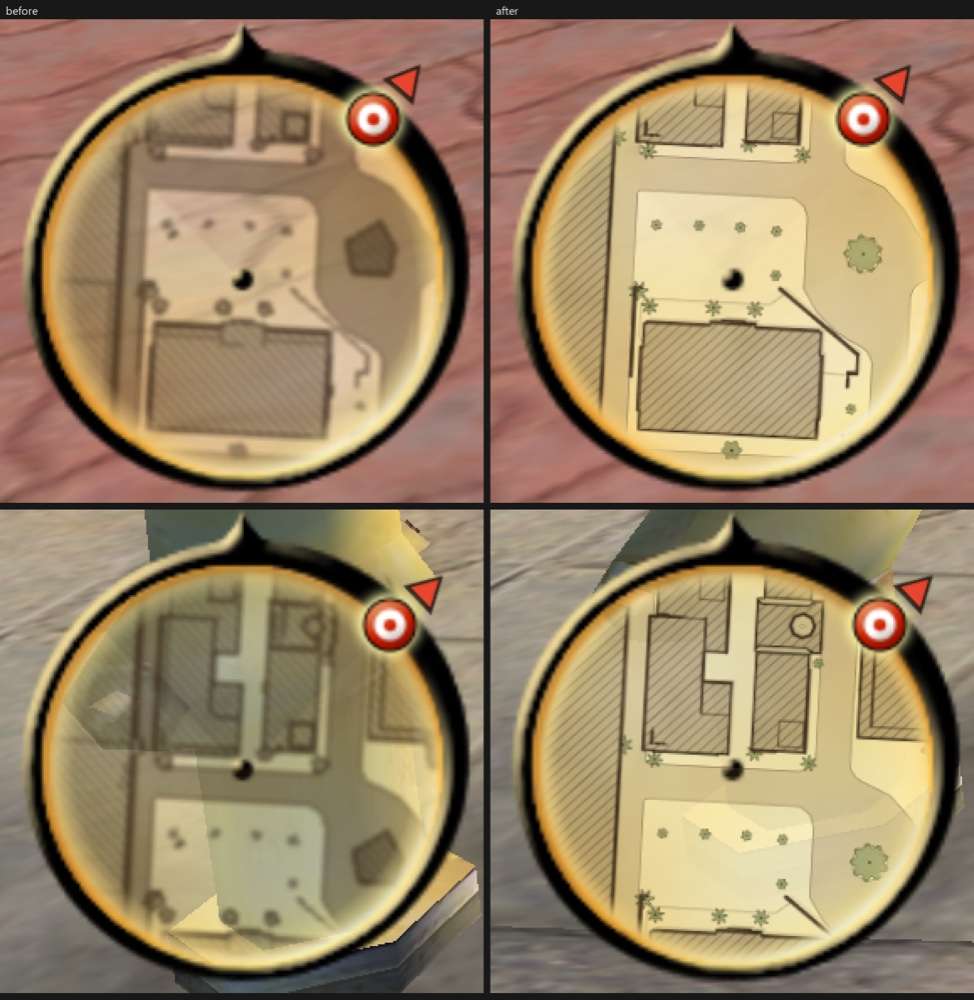

# Minimap and objective markers (`[minimap]`)

## What it does

The round radar at the bottom left gets a hand-drawn map of the surroundings on its parchment: hatched buildings with
ink outlines, roads with kerbs, walls, water, grass, trees as symbols and contour lines on the hills. It turns with the
view (or north up). Objectives beyond the radar's range get an arrow outside the rim, and each objective gets a small
diamond with its distance in the world (an arrow at the screen edge when off screen).

Weapon switching is left to the original game: number keys 1-8 pick a class, the mouse wheel is next / previous
weapon, and RB / LB on the pad. Earlier builds had a weapon wheel that made a tap of X mean next weapon; X is not a
weapon key in the original game but the exit stunt in a car (`do_exit_stunt`, scan code 45).

## How it is implemented

1. **Engine facts (radar).** Class `HUD_radar` (handler 0x6F0C80), main thread 0x6F3AD0. Per frame it reads PlayerPos
   (+68h) and PlayerView (+78h) and places each RadarBlips entry (+34h: sprite, target, type) at BG + Factor x (side,
   -forward), clamped to RadarRadius (+0Ch = 50 m). Mission data adds the blips (`Trigger_Activate_Radar`, ActionType 26
   / 27 / 131). So **objective positions are the blip targets**: the DLL reads the same list and asks each target for its
   world position (GetWorldPosition 0x88CA80). No mission data is parsed or changed.
2. **The map bake.** `hud/tools/bake_minimap.py` reads the collision and the placed model names of every map from the
   player's own files (through `data/gameplay/gamefs.py`, skipping todgameplay_data.zip), and `dist\TODMinimapBake.exe`
   (`hud/bake/minimap_bake.cpp`) draws them: `TODGameplay_minimap\` next to TOD.exe gets one tile pack `.mmp` and one
   `.occ` per map, `minimap.txt`, `bake.json`. A second run skips unchanged maps; a new bake version bakes all again, and
   a map that fails keeps the picture it had. Without the folder the radar stays a radar and the markers still work.
3. **The drawing.** Every tile is rendered from the triangles at 3 x 3 sub-samples per texel, so edges are the
   collision's own straight edges, anti-aliased. Line widths are metres, chosen per level for the size they are seen at.
   Trees and bushes are symbols at their placed positions; small props are left out by name and size. A building is
   what stands above the local ground, falls away at its edges and is not level with a road next to it, so hills and
   viaduct strips are not buildings. Relief is a light wash with a contour line every 4 m. Void stays paper.
4. **Tiles.** 512 px, 4 px border, two levels: 0.25 m per texel (126 m a tile) and 0.5 m (252 m a tile). The level is
   picked by metres per screen pixel. 8-bit palette PNGs with a palette per tile, 39 KB on average.
5. **Streaming (`gp_hud_tiles.cpp`).** A pool of 12 managed 512 px textures with mips. A background thread opens the
   pack, reads, decodes (own inflate, `gp_hud_tile.cpp`) and builds alpha-weighted mips into one of 3 buffers; the render
   thread uploads at most 2 tiles a frame. Tiles are read 30 m before they come into the disc; the one out of use longest
   is replaced. Nothing on the render thread touches the disk.
6. **Drawing the map.** A sprite client of the shared overlay layer for `Radar_BG`: right after the radar background's
   list ran (so the blips, drawn later, stay on top) one quad per tile, rotated by the radar's frame read back from the
   sprite's render list. Stage 0 is the tile (trilinear, LOD bias -0.25, modulated by the heat tint), stage 1 multiplies
   the alpha by a round mask (opaque to 88 % of the radius). Every D3D state read back and restored.
7. **World markers.** A frame client (OV_FRAME 0x421BBF, end of the frame), drawn only on frames whose radar was drawn
   (never in menus, pause, cut-scenes or loading). Projection uses the renderer's view 0 with the game's own fov rule.
   Shapes and digits come from one 1024x128 texture painted with GDI+ at the first draw.
8. **Zoom and north-up.** `zoom != 1` writes the radar's RadarRadius / Factor (no notify, never saved). `rotate = 0`
   edits the points of the radar sprites' own lists each frame.

## Ini keys

| Key | Default | Meaning |
|---|---|---|
| `[minimap] enabled` | 0 | the minimap and markers |
| `[minimap] rotate` | 1 | 1 turns with the view; 0 north up |
| `[minimap] zoom` | 0.75 | 1 = the game's 50 m to the rim; 0.75 = 67 m |
| `[minimap] map` / `map_opacity` | 1 / 0.9 | draw the baked map, its ink strength |
| `[minimap] objective_marker` / `world_marker` | 1 / 1 | rim arrows / world diamonds |
| `[minimap] world_markers_max` / `marker_scale` | 3 / 1.0 | how many world markers, their size |
| `[minimap] map_dir` | TODGameplay_minimap | where the baked maps are |
| `[minimap] perf_log_seconds` | 30 | cost line interval |

A leftover `[weapon_wheel]` section in an older ini is ignored by the DLL; the installer sets its `enabled` to 0.

## Testing and limits

`dll\build.bat` covers the tile code: pack header, level pick, rects, inflate, PNG decode, mips, the paper colour
(`test_hud`), the overlay stubs (host test 20a) and a leftover `[weapon_wheel]` section (host test 20).
`installer/tests/test_installer.py` covers a version change re-baking, a failed map keeping its picture, configs
without blocks in the `filesystem` line, and retiring the wheel key.

Checked in game on the test copy (Downtown save, at 1920 x 1080 and 3024 x 1964): the map is sharp at both sizes and
stays sharp while turning, the blips and pointer stay on top, and it costs 0.03 ms a frame and at most 20 MB of
address space. With Mayhem heat on, the heat tint colours the map with the disc; at heat 5 the disc is plain red and
the ink stays readable, also after a live resolution change. More on costs and what is not verified is in
`hud/README.md`.

Limits: the map is the collision and the placed models seen from above, so the inside of a building is a hatched
block. The first install bakes the maps once, which takes 2 to 5 minutes.

## Files

`dll/src/gp_overlay.cpp`, `gp_hud.cpp`, `gp_hud_tiles.cpp/.h`, `gp_hud_tile.cpp/.h`, `gp_hud_logic.cpp/.h`,
`gp_hud_draw.h`, `tests/dll/test_hud.cpp`, `hud/tools/bake_minimap.py`, `minimap_geo.py`, `hud/bake/minimap_bake.cpp`,
`hud/tools/lib/todcoll.py`, `hud/tools/radar_sim.py`, `hud/README.md`, `dll/HOOKS.md`
"Overlays and the minimap".
