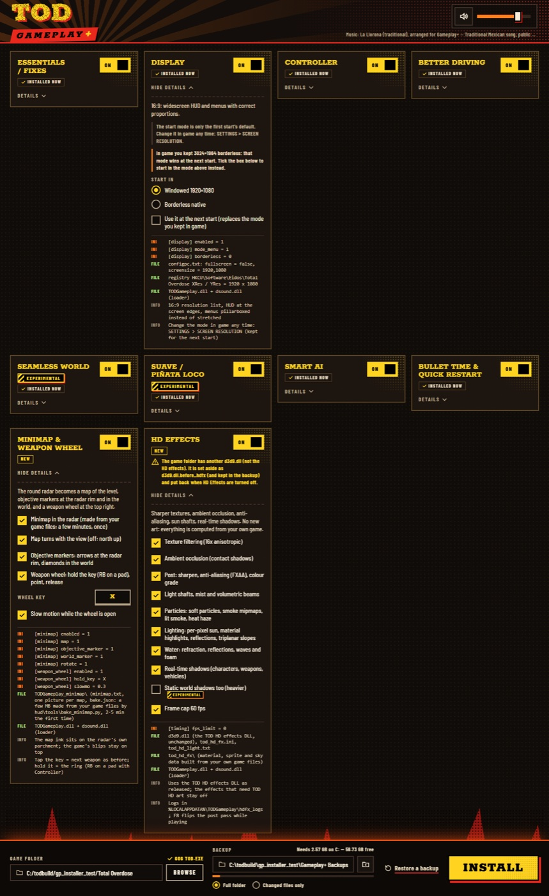

# The installer (`Gameplay Plus Installer.cmd`)

## What it does

A visual installer for the whole mod. The player picks groups on one page (Essentials, Display, Controller, Better
Driving, Seamless World, Suave, Smart AI, Bullet Time & Quick Restart, Minimap, HD Effects, and the nine
Mayhem cards), and it backs the game folder up, builds the data from the player's own files, installs, and can restore
any backup exactly.

## How it is implemented

1. **Start.** `Gameplay Plus Installer.cmd` runs `python -I installer\app.py`: a standard-library HTTP server on
   127.0.0.1 (a free port) and the page in Microsoft Edge app mode. The server quits about 45 s after the window closes.
2. **Checks.** Refuses while `TOD.exe` / `TotalOverdose.exe` runs from that folder. Checks `TOD.exe` against the GOG
   size and md5 (another exe: a warning that the DLL features stay inactive; the exe is never modified). Refuses a
   foreign `dsound.dll` and a backup inside the game folder. Shows required vs free space per drive.
3. **Backup.** The whole folder (default) or only the installer-owned files, into `Gameplay+ Backups` next to the game
   folder. A `manifest.json` holds each file's sha256; every copy is read back before anything is installed.
4. **Plan.** `gpi/plan.py` turns the selection into data options, ini keys, files and display lines. `requires` rules:
   Ragdoll, Car Physics, Chain Reactions and Breakable Cover need Physics; More Enemies needs Difficulty; sub-options
   grey out while their parent is off.
5. **Install steps** (`gpi/engine.py`):
   1. Build the data zip in-process with `data/build_gameplay_mod.py` (static `difficulty` always `normal`), install it
      with `install_gameplay_mod.py` ([data_zip.md](data_zip.md)).
   2. Rebuild `TODGameplay_seamless.txt` when seamless is on.
   3. Copy `TODGameplay.dll` and the `dsound.dll` loader when any DLL group is on; `TODPhysics.dll` only with physics;
      the three MAYHEM `.dds` files with any Mayhem group. A DLL nothing needs is removed.
   4. Merge `TODGameplay.ini` with `seamless/tools/merge_ini.py`: every player line stays, only the planned keys are set,
      a group that is off gets `enabled = 0` (never deleted), a missing section is copied from `dist\TODGameplay.ini`.
   5. HD effects step ([hd_effects.md](hd_effects.md)).
   6. Minimap bake (`hud/tools/bake_minimap.py` as a child process with `-u`, which calls `dist\TODMinimapBake.exe`; map
      n of 9; a failure is a warning, and a map that fails keeps its old picture).
   7. Display: configpc.txt `fullscreen` / `screensize` and the registry XRes / YRes (exported to the backup first).
      These are only the first start's default; a start mode picked in the installer backs up and deletes
      `Documents\Total Overdose\savegames\TODGameplay_display.txt`, the only file outside the game folder it ever
      touches.
   8. `todgameplay_difficulty.txt = menu` when the difficulty menu is on.
   9. `Gameplay+ install.json` (the selection, pre-loaded next time).
6. **Safe writes.** Every file goes to a temp file and is swapped in with `os.replace`; a hard-linked file is never
   written into. Log: `install.log` in the backup folder.
7. **Restore / uninstall.** Verify a backup against its manifest, copy back what differs, remove installer-owned files
   the backup did not have. Restoring the first backup removes Gameplay+ completely.
8. **Never** writes a `debug_*` key (a test checks every set key against the sample ini and the prefix).

## Groups and keys

The full table (group -> data options, ini keys, files, what "off" writes) is in `installer/README.md`. In short:

| Group | Sets |
|---|---|
| Essentials / Fixes | `[fixes]`, `[timing] clock_fix, pickup_step_fix`, `[controls] mouse_turn_fix, diagonal_normalize` |
| Display | `[display] enabled, mode_menu, borderless`; configpc + registry start size |
| Controller | data `controller = menu`; `[pad] enabled, prompts, rumble, rumble_strength` |
| Better Driving | data `driving`, `vehicle_camera`; optional `[vehicles]` keys |
| Seamless World | data `seamless`; `[seamless] enabled, prefetch`; prefetch table |
| Suave | data `suave_anims`, `suave`; `[suave] enabled, slot` |
| Smart AI | `[smart_ai] enabled, squad, morale` |
| Bullet Time & Quick Restart | `[bullettime] enabled, key`, `[restart] enabled, key` |
| Minimap | `[minimap] enabled, map, rotate, objective_marker, world_marker`; the bake. `[weapon_wheel] enabled` goes to 0 in an older ini |
| HD Effects | `tod_hd_fx.ini` keys; `[timing] fps_limit = 0` with its frame cap |
| Mayhem: Physics / Ragdoll / Car Physics / Chain Reactions / Breakable Cover | `[physics] enabled`, `[ragdoll] enabled, impulse_scale`, `[car_physics] enabled, impulse_scale`, `[mayhem] chain_reactions, chain_cars, breakable_cover` |
| Mayhem: Heat | `[mayhem_heat] enabled, escalation, escalation_scale, decay_seconds, tint, icons` |
| Mayhem: Difficulty / More Enemies | data `difficulty_menu`, `difficulty = normal`; `[difficulty] enabled`, `[psycho] enemy_loco_moves, elite_drops`, `[difficulty] max_live_enemies` |
| Mayhem: Bigger Fights (experimental, needs Difficulty) | data `bigger_fights`; `[bigger_fights] enabled`. Old saves do not load while it is on; off brings the zip without it and the `Slot00..` saves back |
| Mayhem: Gang Wars | `[gang_wars] enabled, provoke, spark` |
| MAYHEM title (automatic) | `[mayhem_title] enabled` while any Mayhem group is on |

The Mayhem section plays licensed music stems (`installer/web/mayhem_music.js`), one stem per toggle, sample-locked.

## Testing and limits

- `installer/tests/test_installer.py`: 59 tests (plan mapping, every produced data level exists, every set key exists in
  the sample ini, ini merge keeps player lines, backup / restore round trips byte-identical including a hard-linked
  file, corrupt backup refused, running game refused, foreign dsound refused, space refusal, whole install -> all off
  -> restore on a fake game, the minimap bake process). `run_music_tests.py`: 4 tests in headless Edge.
- End to end on a hard-linked scratch copy with a fake Documents folder, driven through the page: everything on
  (306 s, of which the real bake took 133 s for 9 maps), switch-offs, a second bake, and two restores of the first full
  backup. Afterwards the scratch folder, the fake Documents and the GOG folder were identical by sha256.
- Not verified: an install on a played game folder (by design), the game started from an installer-made install, the
  registry path (every test used `--no-registry`), the PyInstaller one-file build.
- Test flags: `--sandbox DIR`, `--no-registry`, `--documents DIR`.

## Files

`installer/app.py`, `installer/gpi/` (catalog, plan, engine, backup, gamestate, procs, server, repo), `installer/web/`,
`installer/tests/`, `installer/README.md`, `seamless/tools/merge_ini.py`.
