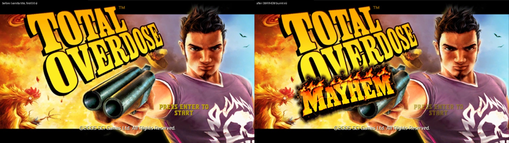

# MAYHEM title (`[mayhem_title]`)

## What it does

The title screen first shows exactly as vanilla. Then an ember ignites at the shotgun's muzzle and a ring of fire burns
a hole through the picture that ends hugging the word MAYHEM, which comes up dark, then glowing, then in colour.
Afterwards: heat shimmer, flickering cracks, a looping fire on the flame tips and a few sparks. The main menu gets the
same burn after "TOTAL OVERDOSE" the first time it appears in a session. Never in game, loading or pause. The installer
turns it on with any Mayhem group.

## How it is implemented

1. **Engine facts.** Every Sprite and TextBox owns a retained render list (+94h). Its per-frame method (vtable slot +20h:
   Sprite 0x8F6CC0, TextBox 0x8FE280) rebuilds the list and submits it to its layer. GfxInternal::Render 0x421B30 ->
   the layer renderer 0x421530 executes each list (0x434290). The title picture is not a quad: it is a full-screen
   picture op (0Fh -> 0x45D940) drawn at the full back-buffer width, 600/800 of that high, centred, and it does not go
   through `[display]`.
2. **Hooks.**
   - MT_SPRITE_VT 0x9D2F70 (Sprite vtable slot), MT_EXEC_A 0x421AB3 and MT_EXEC_B 0x421AE2 (the list executor calls):
     the shared overlay layer. MAYHEM is a sprite client that remembers the list of the node `StartScreen` under
     `StartScreenfolder`, and a list client that draws right after that list ran.
   - MT_TEXTBOX_VT 0x9D3618 (its own): the TextBox `Caption_Yellow` under `GfxFolder` showing "TOTAL OVERDOSE" remembers
     its list (`main_menu = 1` only).
   - 15 REF rows are checked first; all or nothing.
3. **Placement.** Title: a rectangle in title-art pixels (`scale`, `offset_*`) mapped with the picture's own place.
   Menu: right after the caption's glyph quads (read from its list), 2.7 x the caption height x `menu_scale`, so the
   `[display]` menu fit is followed automatically.
4. **Drawing.** One quad with vs_3_0 / ps_3_0 shaders (`gp_mayhem_vs.hlsl` / `gp_mayhem_ps.hlsl`, compiled by build.bat
   with fxc), premultiplied blending, four samplers: the lettering, an fx texture (hole field, flame band, cracks, burn
   noise), a noise texture and the fire flipbook (DXT1, 48 frames at 12 fps). Then the sparks. The shader computes a
   burn time per pixel from the distance to the ignition plus fBm noise. Every render, texture-stage and sampler state,
   texture, shader, constant and stream it touches is read before and restored after. Managed textures survive a Reset.
   A pure device, a card without shader model 3, or any fault turns it off (logged).
5. **Art** (files next to TOD.exe, built from the source lettering and fire clip in `mayhem_title/art/`): `TODGameplay_mayhem.dds`,
   `TODGameplay_mayhem_fx.dds`, `TODGameplay_mayhem_fire.dds`. Without the first two the feature stays off; without the
   fire file the fire layer is skipped. No data change.

## Ini keys (`[mayhem_title]`)

| Key | Default | Meaning |
|---|---|---|
| `enabled` | 1 in the sample, 0 in code | the feature |
| `main_menu` | 1 | burn into the main menu's header too |
| `delay` / `reveal_seconds` / `menu_delay` | 0.6 / 2.0 / 0.25 | vanilla time before ignition; burn length; menu pause |
| `ignite_x` / `ignite_y` | 288 / 350 | ignition point in title-art pixels |
| `scale` / `offset_x` / `offset_y` / `menu_scale` | 1.0 / 0 / 0 / 1.0 | size and position |
| `shimmer` / `fire` / `cracks` / `specks` / `sparks` | 1.0 / 0.55 / 0.6 / 1.0 / 5 | after-effects |
| `perf_log_seconds` | 10 | cost line interval |

Keys from the first version (`intensity`, `angle`, `detail`, `embers`, `flare`) are no longer read; old lines are ignored.

## Testing and limits

- Unit tests `tests/dll/test_mayhem.cpp`; host test 17.
- Checked in game on a test copy of the game at 1920x1080 and 1600x1200: the title before,
  mid-burn and after; the menu mid-burn and after; burnt in when coming back from the load list; no overlay on the
  load list, in game or in pause.
- Cost (CPU side): 0.03 to 0.05 ms per frame on average; art load 56 ms once. GPU time not measured.
- Offline tuning: `python mayhem_title\tools\burn_preview.py NAME --video` (a numpy twin of the shader).
- Open: with the HD effects d3d9.dll, 1 of 12 title captures showed no MAYHEM and one capture 8 s into the title was
  black; this has not been reproduced since.

## Files

`dll/src/gp_mayhem.cpp`, `gp_mayhem_logic.cpp/.h`, `gp_mayhem_ps.hlsl`, `gp_mayhem_vs.hlsl`, `dll/src/gp_overlay.cpp`,
`tests/dll/test_mayhem.cpp`, `mayhem_title/art/` (`build_mayhem_textures.py`, `build_fire_flipbook.py`, the source
lettering and clip), `mayhem_title/tools/`, `dll/HOOKS.md` "Mayhem title".
