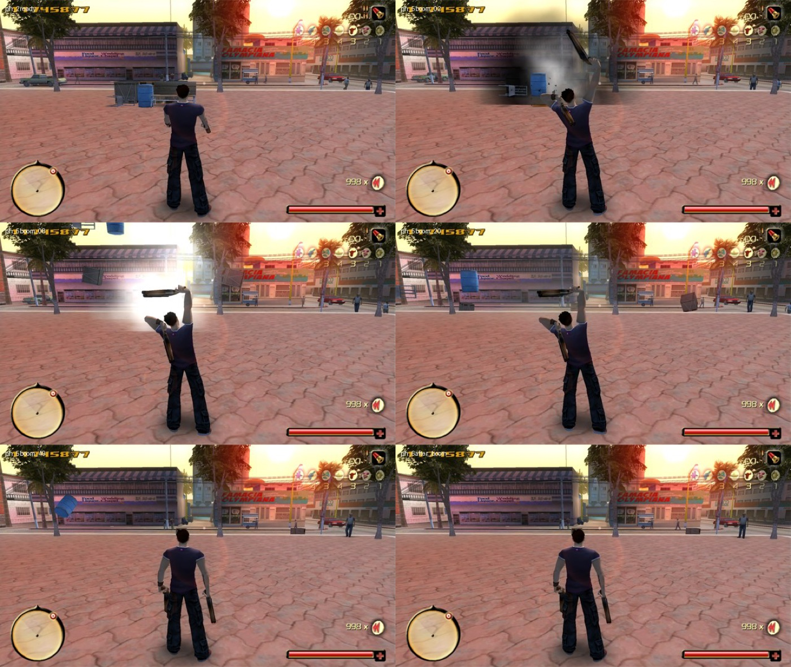

# Box3D physics props (`[physics]`, prototype)

## What it does

Loose props (crates, bins, chairs, benches, barrels ...) become real rigid bodies. They fall and settle on the level,
bullets push them, and grenades, rockets, dynamite and exploding barrels throw them across the street. Cosmetic: the
game still uses its own collision for Ram, the AI, bullets and cars (that collision follows the moved prop).

## How it is implemented

1. **Engine facts.**
   - The level's collision is in the scene tree: per Model a HullList (static chunks) and per pivot a CollisionList
     (VertexClouds, OrientedBoxes, CollisionBoxes). VertexClouds collide as convex hulls.
   - Props are Models with collision pivots; Havok-style props have a `CM` pivot and a `Replace_*` pivot (the broken
     version).
   - The engine's own setters move a node and its collision and quadtree entry: SetPos 0x88D6C0, SetOrient 0x88DB20
     (local to the parent; the stored quaternion is the conjugate of the true rotation).
   - The game dt is at 0xA3DCC4 (slow motion included, 0 when paused).
2. **TODPhysics.dll.** Box3D behind `physics/code/phys_api.h`, single-threaded, no game knowledge. Loaded only when
   `enabled = 1`.
3. **Scan.** While Ram is in control (and again after he walks `rescan_distance` while nothing moves) the scene tree is
   walked once. Every Model within `radius` gives its solid collision. Validated convex hulls (flat patches become 25 cm
   slabs) are merged into ONE Box3D triangle mesh. Models whose path matches `props` (and not `exclude`), up to 1.6 m
   radius, become dynamic bodies built from their pivots' collision (`CM` only when present; `Replace_*` never). Bodies
   sleep until touched.
4. **Each frame** (input tick): the game dt feeds fixed 0.04 s steps (4 substeps). Awake bodies are interpolated between
   the last two steps and written back with SetPos / SetOrient.
   **In a vehicle:** the game stops the on-foot input tick while Ram drives, which would freeze props, wrecks and
   ragdolls. So the per-pass POST_INPUT hook steps the world then, paced by the game-ms clock 0xA3DCD4 (it stands still
   while paused); nothing while paused or in a cut-scene, rewinds as on foot. In a vehicle = player_ai data +24h is the
   vehicle (written by command_drive_vehicle 0x5B5B10, REF PH_PAI_VEHICLE) and its vehicle_ai ControlState +18h is 1.
   Scans are centred ahead of the car (`drive_lead_seconds` of its speed).
5. **Bullets.** PH_BULLET 0x8C95A4 retargets the bullet step's line test (IsLineColliding 0x8B7000). After the original,
   a Box3D ray against the bodies pushes a hit prop at the hit point (`bullet_impulse`).
6. **Explosions.** PH_SHELL 0x848BD2 wraps weapon_shell `command_explode`'s blast (0x8460B0: grenades, launcher,
   rockets, dynamite). PH_DESTROY 0x67145B wraps Destroyable_Object's explosion (0x668BA0: red barrels, gas pumps).
   After the original: a Box3D explosion at the node plus an upward kick (`blast_lift`). Every blast goes through one
   `explode_at`, which also feeds ragdolls, cars and chain reactions.
7. **Rewind** (PlayMode 3): no steps, no writes; afterwards each body is put back where its node now is.
8. **Liveness** every frame: same registry slot, vtable, model asset, parent, not disabled; otherwise the body is
   dropped (a destroyed prop swaps to its broken model and is not simulated).
9. **One world for everyone.** Categories (`physics/code/phys_sim_internal.h`): static 1, props and debris 2, ragdoll 4,
   cars 16, wrecks 32. One step loop runs car sweep -> ragdoll targets -> Box3D step -> ragdoll read-back -> car kicks.

## Ini keys (`[physics]`)

| Key | Default | Meaning |
|---|---|---|
| `enabled` | 0 | the feature (loads TODPhysics.dll) |
| `radius` / `rescan_distance` / `max_bodies` | 40 / 18 / 64 | scanned circle (m), rescan distance (m), body cap |
| `step` / `substeps` | 0.04 / 4 | fixed step and substeps |
| `bullet_impulse` | 25 | N s per bullet or pellet |
| `shell_radius` / `shell_impulse` | 7 / 450 | grenades, rockets, dynamite |
| `destroy_radius` / `destroy_impulse` | 6 / 350 | exploding destroyables |
| `blast_lift` | 4 | extra upward speed (m/s) at a blast's centre |
| `density` / `min_mass` / `max_mass` | 40 / 3 / 80 | prop mass from collision volume |
| `friction` / `restitution` | 0.6 / 0.15 | contact |
| `props` / `exclude` | lists | which model paths are props |
| `log_seconds` | 5 | statistics in the log |
| `drive_step` / `drive_lead_seconds` | 1 / 0.8 | the world also steps while Ram drives; scan lead ahead of the car |

Test-only: `debug_gather`, `debug_gather_key`, `debug_fire_key`, `debug_boom_key`, `debug_kick_key`, `debug_vanilla`, `debug_scan_dump`,
`debug_probe`, `debug_dump_static`, `debug_dump_key`, `debug_shots`.

## Testing and limits

- 176 unit checks in `physics/code/test_phys.cpp` (including the fall-through regression with exact floats); Box3D's
  own test suite passes as a 32-bit exe (`physics/tools/box3d_selftest.bat`); host test 15.
- Checked in game on a test copy of the game at the Downtown City Hall plaza: the game's own
  shell throws crates 13.6 to 25 m and a chair 34.7 m (in vanilla they stay put), and every body's node matched the
  simulation to 0.000 m.
- Cost: 0.023 to 0.050 ms per frame on average with 6 bodies; worst 1.8 ms (first step after a scan); the scan is
  9 to 20 ms once per 18 m walked (a small hitch, not threaded).
- Limits: props are rare and mostly Havok destroyables that the game still breaks; heavy props barely move from bullets;
  explosions are tuned big; the vanilla Havok reaction still runs; the level is only the scanned 40 m circle; Ram
  cannot be pushed by props and does not push them (cars do, see [car_physics.md](car_physics.md)).
- This is a prototype: the installer tags the physics-based Mayhem cards EXPERIMENTAL.

## Files

`physics/code/phys_game.cpp` (glue in TODGameplay.dll), `phys_logic.cpp/.h`, `phys_sim.cpp`, `phys_sim_internal.h`,
`phys_api.h`, `test_phys.cpp`, `physics/tools/`, `physics/README.md`, `third_party/README.md`, `dll/HOOKS.md` "Physics".
