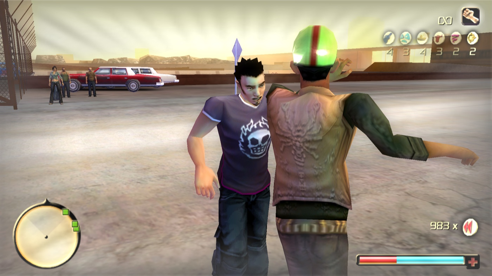

# Suave loco move (`[suave]`, data options `suave` and `suave_anims`)

## What it does

A new loco move on power-up slot 11 (Tequila), or on the Pinata's slot 10 for testing. Ram freezes time, the music
starts, he pulls the nearest enemy into a salsa, the enemies around them form a clapping ring, he hands his partner a
lit dynamite bundle, pushes him away, shoot-dodges off, and the explosion throws the ring while Ram is in the air. Ram
has armor (the game's god mode) for the whole move. Marked EXPERIMENTAL in the installer.

## How it is implemented

1. **Engine facts.**
   - LCONTROL on a slot runs `command_use_power_up` 0x5C0CB0; each of its three use branches starts with a touch call.
     Move eligibility is 0x5BCD90 (no move in a dive, ladder, reload ...).
   - Slot 11 (Tequila) only spent a charge. Nothing in the shipped data ever grants goodie 17.
   - NPCs can be taken over the way the game does it elsewhere: `command_no_ai_control`, parking the MoveCtrl in the
     Victim controller (`Request_new_State(3, 22)`, as EngageBeating), playing clips with native `motion` 5Eh.
   - The grenade hold: `attachnode(slot 3, shell, "l_hand_default", "L Hand")` on the Animation. Pooled shells keep
     node flag 4 (hidden) from their last blast.
   - Ram turns only through the game's own yaw (mouse-turn accumulator or PhysicCtrl.turn_speed); a quaternion write
     sank him through the map.
2. **The gate.** USE_GATE_A 0x5C0CDD, USE_GATE_B 0x5C0D95 and USE_GATE_G 0x5C0E8F retarget the three touch calls. For
   the Suave slot the gate asks the game's eligibility, then looks for the nearest hostile, living enemy within
   `grab_radius` (the Tornado's query 0x486950 and faction test). Refused: the handler exits and the charge is kept.
   Approved: the game spends the charge and the move starts. While Suave runs every other power-up is refused there.
3. **The move** runs from the main loop every frame (the input procedures stop during the freeze):
   - freeze and intro (6 beats): god mode, HUD effect, time to `freeze_scale`, a scripted camera; the partner's AI off;
     Ram and the partner placed so their intro clips start on their marks. The music plays through El Mariachi's sound
     slot (SoundDict 110), pointed at `Suave_Mus_<k>` and pointed back afterwards.
   - gather and dance: up to `ring_max` hostiles within `pull_radius` holster, walk to ring slots, sway on the beat; the
     pair dances; the camera orbits, then cuts every 4 beats.
   - plant: a pooled dynamite shell goes into Ram's hand (flags 1 and 4 cleared), then a 3-stick bundle is held on the
     partner's chest every frame; slow-motion close-up.
   - dive: Ram is turned away by the game's own yaw, the partner's root moves 1.5 m behind him, and W + SPACE go into the
     game's keyboard arrays (the game's own shoot dodge and its clips).
   - boom: in the air, a cut to the partner looking down, a cut back, the shell explodes with owner Ram (the game's own
     blast), then a kill pass over the partner and the ring. Camera, armor, AI and time are given back after the landing.
   - aborts (partner dies early, cut-scene, vehicle, rewind, level change) release everything cleanly.
4. **Data.** `suave_anims` appends 22 clip records and AnimDict slots at the end of GameCamera.fragment, the last
   fragment instanced in overdose.main (appending them in AnimDict.fragment shifted every later node and broke saves).
   `suave` sets the HUD name, an icon stand-in and four STREAMEDSOUNDINFO records for the music segments.
5. **Music.** Four 36-beat segments (124.17 BPM) are cut from the player's own copy of the song into Ogg Vorbis like
   El Mariachi's stream: `suave/audio/song_import.py` does it for the installer, `suave/audio/make_segments.py` for
   developers (from an mp3, with ffmpeg). The song itself never ships and is never in the repo.
6. **Shared memory.** Phase, beat, ring and flags are published in `Local\TODGameplay.Shared.v1` version 2.

## Ini keys (`[suave]`; every timing is in the sample ini)

| Key | Default | Meaning |
|---|---|---|
| `enabled` | 0 | the move |
| `slot` | 11 | 11 = Tequila; 10 = the Pinata's slot (data level `on_slot10`) |
| `cheat_key` | NONE | e.g. F7: +1 charge through the game's own grant (max 2) |
| `grab_radius` / `pull_radius` / `ring_max` / `ring_radius` | 5 / 15 / 8 / 3 | partner and ring selection (m) |
| `auto_dive` | 1 | 0 = the player dives himself |
| `camera` / `faces` / `lock_input` | 1 / 1 / 1 | scripted shots, facial expressions, input lock |
| `dynamite` / `boom_radius` / `boom_damage` | 1 / 7 / 10000 | the blast |
| `music` / `music_slot` | 1 / 110 | music on; the SoundDict entry borrowed |
| `log_verbose` | 0 | every action and a state line every 0.5 s |

Test-only: `debug_start_key`, `debug_shots`, `debug_near_wall`, `debug_rays`, `debug_radius`.

## Testing and limits

- Unit tests `suave/code/test_suave.cpp` (566 checks, the whole move on a fake game), `check_suave.py` (message ids,
  member offsets, calling conventions), host test 8, data tests `tests/data/test_suave_data.py`.
- Played in a real game on slot 10, then checked in game on a test copy of the game in 15 runs with screenshots: the
  dance ring, the bundle on the chest, the panic cut, the takeoff, the mid-air
  explosion, and a tight space with the camera mirrored.
- Stand-ins: the HUD icon is the Time Stop goodie's icon (no texture writer exists).
- Not verified: the pad is not locked during the dance; faces on NPC models; walls inside buildings (only an outdoor
  wall was tested); fences do not block the camera line test.
- The in-game checklist is `suave/TEST_IN_GAME.md`.

## Files

`suave/code/suave_game.cpp`, `suave_logic.cpp/.h`, `suave_msgs.h`, `test_suave.cpp`, `suave/code/tools/`,
`suave/audio/`, `suave/anim/`, `suave/trainer/`, `data/gameplay/suave_data.py`, `data/gameplay/suave_anims.py`,
`suave/README.md`, `suave/TEST_IN_GAME.md`, `dll/HOOKS.md` "Suave".
