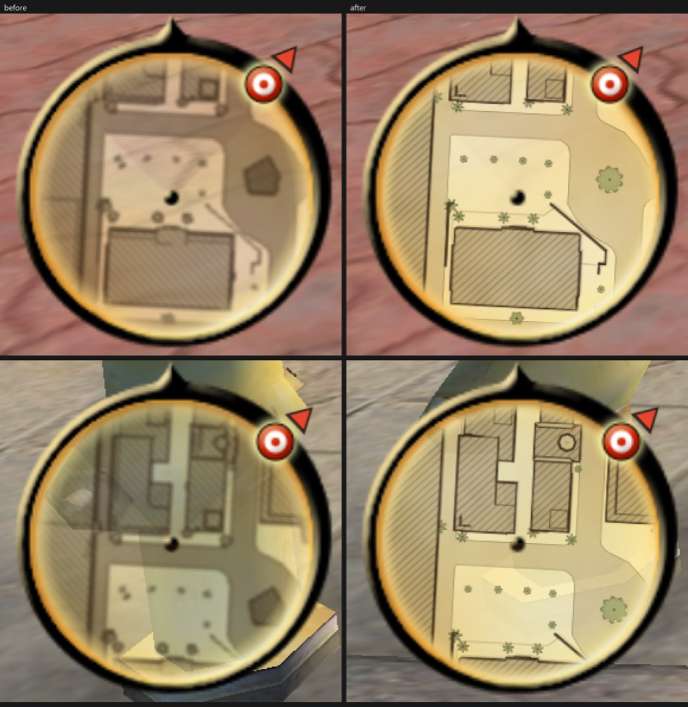

# Minimap and objective markers (`[minimap]`)

A HUD feature of TOD Gameplay+ for the GOG `TOD.exe`, in `TODGameplay.dll`, in the game's ORIGINAL HUD style, off unless
the ini turns it on. An earlier weapon wheel was removed. Weapon switching is the game's own again:
number keys 1-8 pick a class, the mouse wheel is next / previous weapon; on the pad RB / LB. X was never a weapon key
in the original game: it is the exit stunt in a car (`do_exit_stunt`, scan code 45), and only the wheel's own code made
a tap of X mean next weapon.

## What the player gets

The small round radar at the bottom left stays the radar the game draws (its parchment disc, its pointer, its blips:
mission waypoints, objective enemies / allies / objects, the next story mission, enemy dots), and gets:

* a hand-drawn map of the surroundings inside the disc, in ink and wash on the radar's own parchment: buildings hatched
  with an ink outline, roads with kerb lines, walls as heavy ink, water with shore lines, grass, dirt, trees and bushes as
  small symbols at their real places, contour lines on the hills. It turns with the view exactly like the game's blips
  (or north up, `rotate = 0`, then the radar's pointer shows the view). `zoom` sets the range (the game's own blips
  follow).
* an arrow just outside the rim toward every objective beyond the radar's range (the game parks those blips on the rim).
* in the world, over each objective: a small diamond in the blip's colour with the distance under it ("86 m",
  "1.2 km"); off screen or behind the camera it becomes an arrow at the screen edge. The mission's waypoint first, then
  the nearest, at most `world_markers_max`.

The map is made from the player's OWN game files (game data cannot be shipped): `hud/tools/bake_minimap.py` reads the
collision and the placed models of every map, `TODMinimapBake.exe` draws them, and `TODGameplay_minimap\` next to TOD.exe
gets one tile pack `.mmp` + one `.occ` per map, `minimap.txt`, `bake.json`. Without that folder the radar stays a radar
and the objective markers still work.

## How it works (the RE behind it; addresses = GOG exe)

### The radar (HUD_radar, `HUDAuxCtrl.fragment` node `Radar`)
* Class `HUD_radar` (registration 0x6F5360, handler 0x6F0C80), main thread 0x6F3AD0 (Ghidra had not made a function of
  it; decompiled with a copy of the GOG project). Per frame: PlayerPos (+68h, y kept in +74h) and PlayerView (+78h, y
  zeroed); for every RadarBlips entry (+34h, list(s_RadarBlip): {+0 sprite, +4 up-sprite, +8 target, +0Ch type, +10h
  location}) with a target: delta to the target, distance clamped to RadarRadius (+0Ch = 50 m, init 0x6F2254),
  angle against PlayerView, side from the player's local frame, blip at BG + (RadarHalfSize +14h / +18h = 64 / 68) -
  blip half + Factor (+1Ch = 54 / R) x (side, -forward). So the radar is heading-up, 54 radar units = R, far blips sit
  on the rim. The parchment disc of `radar.BMP` (128 x 128) is centred at (64.5, 68), radius 52.5.
* Blip types (texture list order of the init 0x6F1CA0): 0 SubMission, 1 StoryMission, 2 Waypoint, 3 Enemy, 4 Ally, 5
  Neutral, 6 Blowup, 7 Use, 8 Boss, 9 Enemy_Obj, 10 Ally_Obj, 11 Default, 12 / 13 Prim_Gate (13 drawn at 25 %), 14
  Tutorial_Area; `_Up` variants for height differences.
* Who adds them: mission data, `Trigger_Activate_Radar` (ActionType 26 add, 27 remove, 131 clear; RadarType, TargetName /
  TargetEntity): e.g. `Activate_Radar_Blib` 61 records, `ACT_AddBlip_Next_ChkPoint` 55, `ACT_RemBlip_Current_ChkPoint` 157
  over the mission blocks. So **the objective positions are the
  radar blips' targets**: the DLL reads the same list and asks each target for its world position (Node::GetWorldPosition
  0x88CA80) once per frame in the main loop. No mission data is parsed or changed.
* Position on screen: `reinitialize_positions` 0x6F0F00 puts the BG at (BORDER_X - 5, SCREEN_SIZE_Y - BORDER_Y - 125)
  in virtual HUD units; the DLL does not compute that, it reads the BG's quad back from its own render list each frame.

### Drawing
* Shared overlay hooks (`dll/src/gp_overlay.cpp`): the Sprite per-frame render (vtable slot 0x9D2F70) and the two calls
  of the render-list executor in the layer renderer (0x421AB3, 0x421AE2) (first used by the MAYHEM title, now one
  set of patches for every 2D overlay) and the call of the layer renderer in GfxInternal::Render (0x421BBF, OV_FRAME) for
  "after every layer of the frame".
* Map: right after `Radar_BG`'s list ran (so the blips, drawn later in a higher layer, stay on top): one quad per tile of
  the pack in pixels, rotated by the radar frame; stage 0 the tile (trilinear, LOD bias -0.25, modulated by the heat tint),
  stage 1 a 128 px round mask (opaque to 88 % of the radius). Rim arrows in the same pass. Device state read back and
  restored (no state blocks); a pure device turns it off.
* World markers: end of the frame, only on frames whose radar was drawn (so never in menus, pauses,
  cut-scenes or load screens). Projection: the renderer's view 0 (views object [0xA35E04] +24h, 0x114 per view: camera
  matrix +18h, fov +E0h, ratioxy +E4h) with the game's own rule (vertical fov = 2 atan(0.75 tan(fov / 2)), aspect =
  renderer +320h / +324h / ratioxy, or 16:9 with the console flag 0xA39F12).
* Shapes and digits: one 1024 x 128 texture made with GDI+ at the first draw (diamond, arrow, glow, rings; digits in a
  heavy condensed face with a dark outline, like the HUD's score; `~` is drawn as the infinity sign for unlimited ammo).

### The tile map (bake and streaming)
* Old result: one PNG per map from a blurred 1 - 1.73 m per texel raster, 2 MB in all. Blown up to the radar it was mush:
  a wall was a smear, a street had no edges and the collision's noise was everywhere.
* Bake (`hud/bake/minimap_bake.cpp`, driven by `hud/tools/bake_minimap.py`): the collision triangles are rendered per tile
  at 3 x 3 sub-samples per texel, so edges are straight, anti-aliased and independent of any raster. Two levels: 0.25 m per
  texel and 0.5 m per texel, 512 px tiles with a 4 px border. Line widths are in metres and picked per level for the size
  they appear at. The tile pack holds 8-bit palette PNGs, a palette per tile, 39 KB per tile on average.
* Clutter out: small props are dropped by name and size; a building must stand 2.6 m above the local ground, be at least
  4 m^2, fall away at its edges and not be level with an adjacent road, so hills and viaduct strips are not buildings.
  Relief is a light wash with a contour every 4 m, void stays plain paper, and only the map's outer 8 m fades.
* Level choice: metres per screen pixel of the disc (`pick_level`). At zoom 0.75: 1080p (1.82 px/m) draws level 1, 3024 x
  1964 (3.31 px/m) draws level 0.
* Streaming (`dll/src/gp_hud_tiles.cpp`): pool of 12 managed 512 px textures with mips, a below-normal background thread
  reads, inflates and builds alpha-weighted mips into 3 buffers (`gp_hud_tile.cpp`), the render thread uploads at most 2
  tiles a frame. Tiles are wanted 30 m before they enter the disc; the longest unused one is replaced. Nothing on the
  render thread touches the disk, so the pack is never in memory whole.
* Paper: the radar's parchment is see-through, so a paper disc goes in right BEFORE the background's list (`gp_overlay_set_pre`,
  `tiles_underlay`, tile packs only). Behind the background, because on top of it the disc would wash out the rim and pointer.
* An older bake's `.png` still draws through the old path, so a map that fails to bake keeps the picture it had.

## ini

See `dll/TODGameplay.ini` `[minimap]`: `enabled, rotate, zoom, map, map_opacity, objective_marker, world_marker,
world_markers_max, marker_scale, map_dir, perf_log_seconds`. A leftover `[weapon_wheel]` section in an older ini is ignored
by the DLL (host test 20) and the installer sets its `enabled` to 0.

## Files

| Path | What |
|---|---|
| `dll/src/gp_overlay.cpp` | shared overlay hooks (sprite list, list executor, end of frame) + 2D device state helpers |
| `dll/src/gp_hud.cpp` | [minimap]: radar reads, rim arrows, world markers, the shared UI texture / text |
| `dll/src/gp_hud_tiles.cpp/.h` | tile streaming: pool, background thread, uploads, the quads and the disc mask |
| `dll/src/gp_hud_tile.cpp/.h` | pure tile code: pack header, level pick, tile rects, inflate, PNG decode, mips |
| `dll/src/gp_hud_logic.cpp/.h`, `gp_hud_draw.h` | pure maths (radar frame, disc, map index, projection) + the draw helper interface |
| `tests/dll/test_hud.cpp` | unit tests of the maths; host test 18 in `tests/dll/host.cpp` |
| `hud/tools/bake_minimap.py`, `minimap_geo.py`, `lib/todcoll.py` | the bake driver (stdlib only): reads the game files, writes the baker's input, `bake.json` |
| `hud/bake/minimap_bake.cpp` | the native baker, `dist\TODMinimapBake.exe`: classes, drawing, tile packs |
| `hud/tools/radar_sim.py` | dev: a baked mosaic through the radar's filter chain, to judge the look offline |

## Testing

Checked with an in-game test harness on a copy of the game (not included): scripted key / pad runs that record clips
and stills. Each run left the test copy, the real saves and the GOG files
byte-identical, and the registry back at 1920 x 1080. "Before" below is the older bake drawn by the same DLL in the same
save at the same place.

* Before and after in the same save at two places, at 1920 x 1080 and at 3024 x 1964 (borderless).
* The map turning with the view (right stick, 1080p, level 1: the worst case for shimmer) and walking through Downtown.
* Weapon switching as in the original game: key 2 picks the class, X does nothing on foot, RB is next weapon, no slow
  motion.
* Objective blip, rim arrow and world marker (diamond and edge arrow) during a mission; north up (`rotate = 0`,
  `zoom = 1.5`); 4:3 at 1440 x 1080. These three were checked with the older map picture; the markers are unchanged.

### Costs (from the DLL's own log, at 1920 x 1080 and 3024 x 1964)
* Map + paper + rim arrows: 0.028 - 0.037 ms a frame on average at both sizes; 20 s window maxima 0.15 - 2 ms. World markers
  0.010 - 0.012 ms.
* First tiles of a level: the worst single frame was 4.3 ms at 1080p and 14 ms at 3024 x 1964, once. Each upload takes 0.37 -
  0.55 ms on average, 0.87 ms at most, at most 2 a frame.
* Background thread: pack open 0.3 - 1.5 ms, a tile read + inflate + mips 2.4 - 7 ms on average, 41 ms at most (on a busy
  machine). The player does not wait for it: a tile that is late only shows as plain parchment for a moment.
* Level's first frame with setup (UI texture): 31 ms, the older bake's whole-map PNG 113 ms in the same save.
* Memory: 20 MB of address space at most (12 textures 16 MB + 3 buffers 4 MB), the mask 0.1 MB, nothing loaded whole. Pool used:
  13.3 MB at 1080p, 16 MB at 3024 x 1964. The older bake's biggest picture was 8.8 MB. Address space while playing Downtown:
  715 - 719 of 2048 MB at 1080p, 760 - 767 at 3024 x 1964.
* Bake (installer, once): 148 s and 23 MB for the 9 maps on 8 threads on a busy machine; the older bake was 2 MB.
  Run over a test install's older folder it replaced all 9 PNGs, byte-identical to a clean bake; a second run said
  "up to date" for all 9 in 2 s.

## Known limits (not verified yet)
* Driving: the street save's script found no car. The map uses the same radar frame in vehicles, but that is not
  shown in game. Fast movement through tiles was not measured; the walk's sampled frames show no late tile.
* Keyboard next / previous weapon: the mouse wheel cannot be scripted, so it was not pressed. No code of the mod touches it now.
* A physical pad (the runs used the DLL's scripted pad).
* The packed installer exe running the new baker; the bake ran from the command line and from the installer's tests with a fake.
* All nine maps in game: Downtown and the Farm were played and Industrial drew at the start of each run; the others were judged in
  the radar simulator and in overviews.
* The heat tint on the new paper disc: it uses the same tint value as the tiles, but no run had a tinted radar.
* Hiding world markers behind walls: not done; the marker is drawn over everything.
