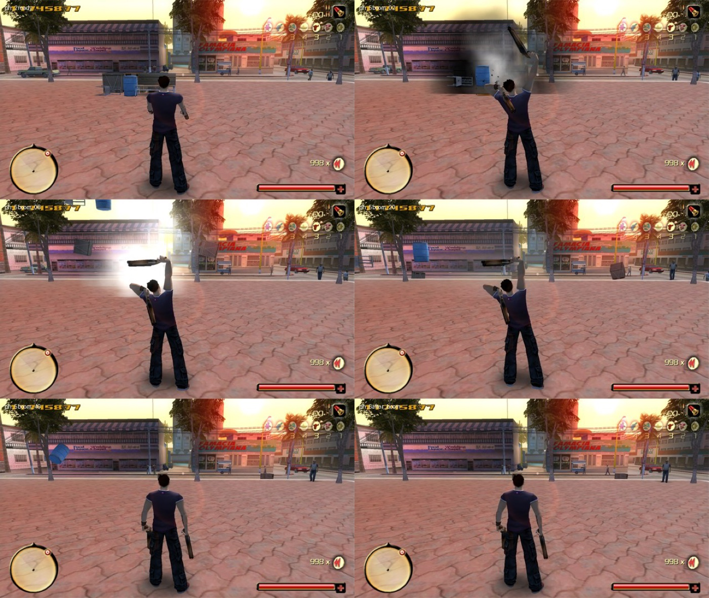

# [physics]: Box3D props in the original Total Overdose

Loose props (crates, bins, chairs, benches ...) become rigid bodies of **Box3D** (Erin Catto, MIT, `third_party/box3d`,
pinned commit `3362633`) inside the GOG `TOD.exe`. They fall and settle on the level's own collision, take a push from
every bullet that hits them, fly when a grenade, rocket, dynamite or an exploding destroyable goes off next to them,
tumble and come to rest. The game draws them where the simulation puts them.

The effect is cosmetic: their collision for Ram, the AI, bullets and cars is still the game's own (it follows the moved
node).

**Off by default** (`[physics] enabled = 0`). With it off nothing is patched and `TODPhysics.dll` is not loaded.



## Performance

Measured in game on the Downtown City Hall plaza (6 bodies, 379 static level pieces):

| What | Cost |
|---|---|
| Physics step | 0.009-0.044 ms average per 0.04 s step |
| Write-back | 0.005-0.036 ms average per frame |
| Whole physics frame | 0.023-0.050 ms average |
| Worst frames | 1.1 ms (the explosion frame), 1.8 ms (the first step after a scan builds the level mesh) |
| Scan | 9-20 ms, once per 18 m walked |
| Unit test, 40 stacked boxes (32-bit build) | 0.08 ms per step (max 0.19 ms) |

After the game's own shell explosion the crates are thrown 13.6, 18.6 and 25.0 m (turned up to 115 deg), the chair
34.7 m, the bin 5.2 m and onto its side; every body's game node equals the simulated pose (0.000 m off). In the vanilla
game the crates do not move.

## How it works

| Part | Where | What |
|---|---|---|
| `TODPhysics.dll` | `code/phys_sim.cpp` | Box3D world behind a C function table (`code/phys_api.h`); single-threaded (`workerCount = 1`), no game knowledge. Loaded by TODGameplay.dll only when enabled |
| glue | `code/phys_game.cpp` (in TODGameplay.dll) | scan, tick, write-back, the 3 hooks, liveness, test-copy debug keys |
| pure logic | `code/phys_logic.cpp/.h` | TOD matrix / stored-quaternion conventions, hull preparation (slabs for flat patches), prop names, step clock, config |
| tests | `code/test_phys.cpp` (176 checks, run by `dll\build.bat`), `tools/box3d_selftest.bat` (Box3D's own suite as x86) | |
| clips | `tools/make_proof_video.py` (side-by-side video of two test runs) | |

1. **Scan** (Ram in control; again after he walks `rescan_distance` while nothing moves): the scene tree is walked
   once. Every Model within `radius` gives its Solid collision: the HullList (static level chunks) and every pivot's
   CollisionList through the pivot node's world matrix, plus CollisionBox entities. VertexClouds collide as their
   convex hulls (as in the game); flat patches become 25 cm slabs below floors and around walls. All of it becomes ONE
   Box3D triangle mesh (the faces of each validated hull). Models whose path matches `props` (not `exclude`), up to
   1.6 m radius, become dynamic bodies made of the collision of their pivots (the `CM` pivot only when there is one;
   the `Replace_Model` pivot is the broken version and never counts). They sleep until something touches them.
2. **Each frame** (input tick, once per main-loop pass): the game dt `[0xA3DCC4]` (slow motion included, 0 when paused)
   feeds fixed 0.04 s steps (4 substeps). Awake bodies are interpolated between the last two steps and written back
   with the engine's own `SetPos 0x88D6C0` / `SetOrient 0x88DB20` (local to the parent; the stored quaternion is the
   conjugate), which also move the node's collision and quadtree entry.
3. **In a vehicle** (`drive_step = 1`): the game stops the on-foot input tick while Ram drives, so the per-pass
   POST_INPUT hook steps the world instead (`drive_frame`), paced by the game-ms clock `[0xA3DCD4]` (still while
   paused, back on a rewind), never while paused or in a cut-scene. "In a vehicle" means player_ai data +24h holds a
   vehicle whose vehicle_ai ControlState is 1 (REF PH_PAI_VEHICLE, `dll/HOOKS.md` Physics). Scans then lead the car by
   `drive_lead_seconds` of its speed. Without this, props, wrecks and ragdolls would freeze whenever Ram sits in a car.
4. **Bullets**: the bullet step's line test call (0x8C95A4 -> `IsLineColliding 0x8B7000`) is wrapped. A segment that
   hits a body (and the game's own hit node is that prop, or the game saw no hit) pushes it at the hit point
   (`bullet_impulse` per bullet or pellet).
5. **Explosions**: weapon_shell `command_explode`'s blast call (0x848BD2 -> 0x8460B0: grenades, launcher, rockets,
   dynamite) and `Destroyable_Object`'s explosion call (0x67145B -> 0x668BA0: red barrels, gas pumps ...) are wrapped.
   Each gives a Box3D explosion at the node (`*_radius`, `*_impulse` per area) plus an upward kick (`blast_lift`).
6. **Rewind** (PlayMode 3): no steps, no writes. Afterwards every body is put back where its node now is.
7. **Liveness** every frame: the entity registry slot still holds the node (`~Entity` clears it), same vtable, same
   model asset, not disabled, same parent. Otherwise the body is dropped (a destroyed Havok prop swaps to its broken
   version and is logged as "dropped (disabled)").

## Settings

Copy `dist\TODPhysics.dll` and `dist\TODGameplay.dll` next to `TOD.exe` and set in `TODGameplay.ini`:

```
[physics]
enabled = 1
```

Then shoot or blow up crates, bins, chairs or benches (Downtown has a few along the streets east and west of the City
Hall plaza). Every key is listed in `dll\TODGameplay.ini`, section `[physics]`. Statistics go to `TODGameplay.log`
every `log_seconds` (bodies, awake, step / write / frame ms).

## Testing

Debug keys for the test copy only (never in a played game):

| Key | What |
|---|---|
| `debug_gather = crate,/bins/,chair,bench` | puts those props in front of Ram |
| `debug_fire_key` | holds the left mouse button |
| `debug_boom_key` | makes the game explode a pooled weapon_shell among the props |
| `debug_kick_key` | a Box3D-only blast |
| `debug_vanilla = 1` | keeps the rig and keys but runs no simulation (for "before" comparisons) |
| `debug_scan_dump`, `debug_probe = x,z`, `debug_dump_static` | diagnostics |

The tests ran through an in-game test harness on a copy of the game (not included), which loads a save, plays scripted input and grabs screenshots at the marks the DLL logs.

## Known issues

* Props are rare in TOD's levels and nearly all are Havok destroyables: the game still breaks them when shot or blown
  up (a bin dies after a few pellets). The broken version is not simulated (the body is dropped).
* `SetWorldPosition` cannot move Ram (his physics controller owns his position), so the in-game tests bring the props
  to him (`debug_gather`).
* Bullet pushes on heavy props are small: a CrateSmall is 1.7 m^3 of collision, so 69 kg (density 40, max 80); a
  shotgun's ten pellets move it a few centimetres. Light props (bins, chairs: 18 kg) move clearly.
* Explosions are tuned big (chair 35 m, crates 14-25 m with `shell_impulse = 450`). Lower `shell_impulse` and
  `blast_lift` for realism.
* The vanilla Havok reaction still runs (the bin hops in the vanilla game too) and can briefly fight the simulation.
* The static level is the collision near Ram at the last scan (40 m). A prop thrown farther lands on whatever was
  scanned. A rescan rebuilds the world from the nodes as they are.
* The scan and the level mesh build cost 10-25 ms once per rescan (a hitch). It is not threaded.
* Only Model props with collision are simulated. Character-held items, pickups (they have their own prop_move_ctrl),
  vehicles and their parts are never touched.
* Box3D is alpha (2026); x86 needs the two-line intrinsic patch in `third_party/box3d_x86.patch`. One Box3D hull of a
  near-coplanar level patch let a crate fall through the plaza (in game and in an offline replay of the exact floats),
  which is why the level is a triangle mesh (there is a regression test with those points).

## What fuller gameplay physics would take

* **Props that block bullets, AI and Ram**: they already do through the game's own collision of the moved node. To
  make the *player and cars push props*, Ram's and every car's capsule and boxes would have to enter Box3D as kinematic
  bodies each step (positions from the character PhysicCtrl and car_move_ctrl), and contact impulses back to the game
  would need hooks in the character integrate (0x57C220 / 0x59C740) and car step (0x4F8F10). Their controllers are not
  written for external forces. (Car pushing is done in one direction by `[car_physics]`, see [CARS.md](CARS.md).)
* **AI**: navigation is authored graph data (traffic points, GotoPath tracks), not collision. Moved props would need
  NavBlock updates or a dynamic obstacle query in `CheckObstacle 0x91DD40`.
* **Ragdolls**: now a feature of their own, see [ragdoll/README.md](../ragdoll/README.md). TOD has none of its own; characters are 50-bone bipeds posed by
  `Character::UpdatePose 0x90FFF0` / compose 0x90EA50, and the bone write path exists (FUN_005A1710 per bone).
* **Cost**: Box3D at 32-bit is far below a millisecond for dozens of bodies. The expensive parts would be the scan
  (move to load time, block by block) and per-frame transform writes for many bodies.
