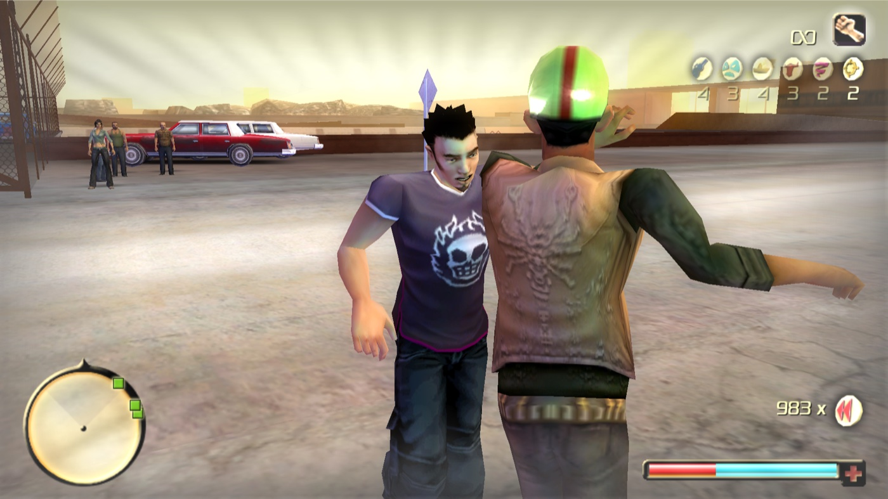

# Suave: the new loco move (code, music and data)



Suave replaces power-up slot 11 (Tequila, whose use button only spent a charge). Ram freezes time, the music starts,
he pulls the nearest enemy into a salsa, the enemies around them form a clapping ring, he shows the game's own lit
dynamite in his hand and hands it to his partner, pushes them away, shoot-dodges away and the explosion throws the ring
while he is in the air. He has armor (the game's god mode, as El Mariachi) for the whole move.

## Status

Experimental. The move has been played in game on slot 10 (the Pinata route) and checked in repeated scripted runs in an
in-game test harness on a copy of the game (not included), with screenshots. Verified there: the dynamite bundle shows on the
partner's chest with lit fuses, Ram turns and shoot-dodges forward away from the partner toward the low front camera,
the explosion goes off behind him in the air, nobody sinks into the floor, the guns leave the partner's and the ring's
hands, and a tight spot by a wall shrinks the ring and keeps the cameras inside. What is still open is listed under
"Stand-ins and unknowns" below and in the in-game checklist, [TEST_IN_GAME.md](TEST_IN_GAME.md).

The clips are made in [`anim/`](anim/README.md). The browser preview of the whole move is the
[Suave trainer](trainer/README.md).

## What is where

| Part | Where | What |
|---|---|---|
| Move logic (pure) | `code/suave_logic.h/.cpp` | phases, timeline, partner / ring selection, ring slots, camera director, faces, aborts; unit tested |
| Game glue | `code/suave_game.cpp`, `code/suave_msgs.h` | the use-power-up gate, game reads, the game's own messages; compiled into `TODGameplay.dll` |
| Tests | `code/test_suave.cpp`, `code/tools/check_suave.py`, `code/tools/callconv.py`, `tests/dll/host.cpp` section 8 | see "Verification" |
| Music | `audio/song_import.py`, `audio/fingerprint.json`, `audio/make_fingerprint.py`, `audio/make_segments.py`, `audio/segments.json`, `audio/analyze_song.py` | 4 segments cut from the PLAYER'S OWN copy of the song (`song_import.py`, no ffmpeg; the installer runs it) or from a developer's mp3 (`make_segments.py`, ffmpeg) into a build folder (`audio/build/` is git-ignored; never the mp3; the segments never ship). `fingerprint.json` is the small non-audio envelope that finds the song in the player's file |
| Data | `data/gameplay/suave_data.py`, option `suave` in `data/gameplay/options.py`, step in `builder.py` | HUD name, icon stand-in, start charges, music stream records + oggs |

## How it works in the game

1. **Activation (the game's own path).** LCONTROL on slot 11 runs `command_use_power_up` (0x5C0CB0). Its three use
   branches start with a touch call; the DLL retargets those calls (sites `USE_GATE_A/B/G`) to a gate. For slot 11 the
   gate asks the game's move eligibility (0x5BCD90: no move during a dive, ladder, reload ...), then looks for the
   nearest hostile, living, killable enemy (sentry AI) within `grab_radius` (Tornado query 0x486950, mask 40h, the
   Tornado's faction test). Refused: the handler exits without spending (charge kept, logged). Approved: the game
   spends the charge itself and the move starts at the next input tick. While Suave runs every other power-up is
   refused at the same gate.
2. **Freeze + intro (6 beats).** God mode (`induce_god_mode`, the El Mariachi call), HUD power-up effect, time to
   `freeze_scale` (TIME_CTRL `trigger_slowmotion`), the camera (free node RamLogicCamTarget, `camera_basic_ai`
   cut_to / transition_to / look_at, real-time camera like the power-up menu) pushes in on Ram. Ram's MoveCtrl is parked
   in the Victim controller (`Request_new_State(3,22)`, as EngageBeating) and his weapon in the special-move state; the
   partner's AI is switched off (`command_no_ai_control`), collision off. Start positions: Ram is turned toward the
   partner minus the intro's start angle (44.7 deg) and his node moves 0.36 m so that his intro Bip (x +0.23, z -0.28
   of the node) starts exactly on his spot; the partner's node goes onto the same node and his clip carries him from
   about 1.1 m out, turned away, into the hold. Ram plays `suave_intro_<p>`, the partner `suave_grabbed_<p>` (native
   `motion` 5Eh). At the freeze end the music starts: El Mariachi's SoundSlot (SoundDict 110) is pointed at
   `Suave_Mus_<k>` (the property setter 0x89E270) and played with `Play_Speak` exactly as El Mariachi plays it; it is
   pointed back afterwards.
3. **Gather / dance.** The ring (up to `ring_max` hostiles within `pull_radius`) loses AI control, holsters
   (`switch_to_unarmed`) and walks (`auto_move_to_worldpos` + `command_walk`) to slots on a `ring_radius` circle (no
   crossing paths), is parked and plays `suave_circle` with a 1-beat phase per member (one sway per beat: neighbours
   sway to opposite sides), facing the centre. Late walkers are teleported to their slot. The pair dances
   `suave_lead_<p>` / `suave_follow_<p>` (speed 1.0); the camera orbits high, then cuts every 4 beats: low hero / over
   the partner's shoulder / a ring member's view / wide.
4. **Plant + ending.** `dynamite_show` (0.8 s) before beat 19 of the dance a free dynamite shell (weapon_shell pool,
   type 3, owner the partner: morph, aim lights the fuse) goes into Ram's hand: `attachnode(slot 3, shell,
   "l_hand_default", "L Hand")` on his Animation, the game's own grenade hold (in 0x5055B0 / 0x5A2EC0); two more
   sticks are armed hidden. **Node flag 4 hides a shell's model** (the explode handler sets it after a blast, 0x848B7E;
   `command_release_grenade` clears it with 0x62E1B0 when a grenade leaves the hand): pooled shells keep it from their
   last blast, which would leave only the fuse sparks visible, so the DLL clears flags 1 and 4.

   On beat 19 `suave_push_<p>` / `suave_stumble_<p>` play, and `attach_seconds` later (the push contact) the stick
   leaves Ram's hand and the bundle (`dynamite_sticks`, 3) is held by the DLL on the partner's chest every frame:
   Spine2 + `dynamite_out` along his body's forward (the shoulder line, signed toward Ram), side by side, sticks across
   the chest; slow-motion chest close-up (`plant close-up`, 1.7 m, fov 42). The front camera waits for the dive.

   Ram is released, lifted onto the collision floor if his root sits under it, and turned away from the partner
   (toward the most open side within 75 deg when a wall is near) by the game's own yaw: the mouse-turn accumulator the
   physics turn step consumes (`mouse_turn_fix`, set not added), else `PhysicCtrl.turn_speed` written right after the
   input procedure (0x57D504 turns by turn_speed x TimeStep); there is no write to his orientation. A request waits
   until his facing has settled (six still frames: under the slow motion the physics steps are frames apart). Within
   `turn_tolerance_deg` the remaining yaw is cleared, the partner's root moves `partner_clear` (1.5 m) behind Ram (with
   the partner's root left on Ram's spot every forward or back dive sank into the floor, collision off or not) and
   W + SPACE go into the game's own keyboard arrays. If the turn is not done within `turn_seconds` the key is chosen by
   his actual facing (S back, A / D side). The low front camera then cuts in `front_distance` (5 m) ahead along the
   actual dive, `front_height` (1.2 m) up, looking back at Ram and the partner. Ram is put back on the takeoff floor if
   he sinks `ram_ground_snap` below it. With `auto_dive = 0` the player gets the keys and the gameplay camera back and
   dives himself.

   The dive is the game's own shoot dodge, so the game plays its own `ram_shootdodge_front_{jump,midair,land}` clips
   and landings / get-ups (the code does not name them). The partner plays `suave_lookdown_<p>` (terrified face) right
   after the stumble's last frame (release + `push_seconds` 2.2 s; lookdown frame 0 = the stumble's last frame), or at
   the in-air cut if that comes first. In the air: cut to the partner looking down, cut back to the front angle, then
   **the explosion**: the shell explodes with the owner set to Ram and its radius set to `boom_radius` (the game's own
   blast: effect, sound, damage, impulses), camera shake + explosion slow motion as a barrel blast sends them, then a
   kill pass (`take_a_hit`, owner Ram, explosive damage type, impulse away from the blast) over the partner and every
   ring member still alive. After the landing the camera blends back, the armor is cut (as El Mariachi shortens its
   god time), and survivors get their AI back.
5. **Aborts.** The partner dies before the plant, a cut-scene, a vehicle, the player not in control (menu), a
   rewind or a level change: everything is released cleanly (NPC AI back, Ram's controller and weapon back, time,
   camera, music, armor, input). A level change or rewind sends nothing to NPCs.
6. **Faces.** `character_face_ctrl` `command_facial_expression` with the AnimDict `PlayerAnims/Facials` ids
   (slicksmile 6, joy 3, surprise 7, disbelief 2, pain 4) on Ram, the partner and the ring at set moments of the move.
7. **Exposure.** Shared memory `Local\TODGameplay.Shared.v1`, version 2 (128 bytes): `suave_phase`, `suave_clock`,
   `suave_phase_t/len`, `suave_dive_at`, `suave_beat`, ring centre and radius, members, flags (`TODGP_SV_ARMOR` = god
   mode, music, dynamite, boom, input locked), the camera shot, uses / aborts. No shield visual is implied.

## Settings (TODGameplay.ini `[suave]`, all off by default)

`enabled = 0` turns everything off; nothing is patched then. Every timing and radius is in the sample ini
(`dll/TODGameplay.ini`) with its default. The main ones:

| Key | Default | |
|---|---|---|
| `enabled` | 0 | the move on slot 11 |
| `cheat_key` | NONE | e.g. F7: +1 charge through the game's own grant (max 2) |
| `grab_radius` / `pull_radius` / `ring_max` / `ring_radius` | 5 / 15 / 8 / 3 m | selection and ring |
| `freeze_seconds` / `freeze_scale` | 0.6 s real / 0.05 | the activation freeze |
| `intro_beats` / `gather_lead_beats` / `gather_beats` | 6 / 2 / 4 | intro, ring walk-in |
| `intro_place` / `intro_x` / `intro_z` / `face_offset_deg` | 1 / 0.23 / -0.28 / 44.7 | the intro start positions |
| `ring_phase_beats` / `push_seconds` | 1 / 2.2 s | ring sway offset; the look-down follows the stumble |
| `release_beat` / `dance_cycles` / `dance_beats` | 19 / 1 / 24 | push timing (dance frame 230) |
| `attach_seconds` / `closeup_seconds` / `dive_at_seconds` | 0.4 / 1.1 / 1.4 s | plant, close-up, release for the dive |
| `auto_dive` | 1 | 0 = the player dives (keys and camera back at the dive window) |
| `cut_lookdown_*` / `panic_min` / `panic_max` / `panic_lift` / `panic_ram_speed` / `blast_after` / `blast_max_*` | 0.3 / 1.4 / 2.2 s / 0.5 m / 0.3 / 0.3 s / 4.5 s, 1.5 game s | the panic cut (the partner looking down at the sparking bundle) 0.3 s after the takeoff, 1.4..2.2 s on screen, cut back once Ram is 0.5 m up; while airborne in it Ram's own animation runs at 0.3 (the world slow motion does not slow the player) and ramps back at the cut back; the blast 0.3 s later, in the air. `cut_back_*` / `blast_real|game` are no longer read |
| `dive_wait` | 1.5 game s | no takeoff: explosion anyway |
| `camera` / `faces` / `lock_input` | 1 / 1 / 1 | switches |
| `dynamite` / `dynamite_show` / `boom_radius` / `boom_damage` | 1 / 0.8 s / 7 m / 10000 | the blast; Ram shows the stick this long before the push |
| `dynamite_sticks` / `dynamite_out` / `dynamite_drop` / `dynamite_gap` | 3 / 0.22 / -0.12 / 0.07 m | the bundle on the partner's chest (in front of Spine2, above it, side by side) |
| `dynamite_ram_hand` / `dynamite_grip` / `dynamite_slot` | L Hand / l_hand_default / 3 | Ram's hold, the game's grenade hold (`dynamite_bone` / `dynamite_pivot` / `dynamite_partner_hand` are no longer read) |
| `turn_seconds` / `turn_tolerance_deg` | 1.0 real s / 15 | the turn before the dive keys |
| `dive_clear` / `partner_clear` / `dive_step` / `ram_ground_snap` | 0.6 / 1.5 / 0 / 0.35 m | nothing overlapping Ram at the takeoff; Ram never below the takeoff floor |
| `front_distance` / `front_height` / `dive_cam_distance` | 5 / 1.2 / 4.5 m | the low front cameras, placed after the dive is final |
| `space_probe` / `camera_clamp` | 1 / 1 | the free-space rays (ring size, dive side) and the camera kept out of walls |
| `enemy_weapons` | 2 | 2: the gun stops firing and drops through its own `command_drop` (it falls); 3: stops firing and is hidden (shown again for survivors); 1 holster only; 0 keep |
| `turn_sign` / `dive_side_sign` | 1 / 1 | the yaw sign of the mouse turn (measured: +1) and which side D dives |
| `music_soldier` / `music_civil` / `music_dea` / `music_other` | 1 / 2 / 3 / 4 | segment per partner model (0 = random) |

## Music

The segments are not shipped. The installer's Suave card takes the player's own copy of the song and
`audio/song_import.py` cuts the same four segments on their PC (see `installer/README.md`, "The Suave song"); without
a file Suave runs without music (`[suave] music = 0`, data option `suave_music = off`). Tests:
`python -I suave\audio\test_song_import.py` (needs numpy + soundfile). The text below describes the cut itself, which
`song_import.py` reproduces in numpy (same beat grid, fades, level; the ogg is libvorbis through libsndfile instead of
ffmpeg).

`audio/make_segments.py` (reproducible from the mp3 path; pass `--mp3` and `--ffmpeg`) cuts 36-beat segments (9 bars,
17.396 s, 767,144 samples) on the song's beat grid from `anim/src/bpm.py` (124.17 BPM, first beat 0.373 s, downbeats
every 4 beats), each starting on a downbeat with a 0.25 s fade-in and a 0.45 s fade-out, loudness matched to El
Mariachi's own stream, encoded like it (Ogg Vorbis, 44.1 kHz, mono, 80 kbps). Segment k starts at the move's c = 0
(the intro's downbeat) and runs through the explosion (about beat 30-32) into the aftermath.

| Segment | Partner | Song beats | Song time | Picked for |
|---|---|---|---|---|
| suave_mus_1 | soldier | 32-68 | 15.836-33.231 s | first full groove after the intro (the preview start) |
| suave_mus_2 | civil | 64-100 | 31.298-48.694 s | bright, brass-heavy (high band, high centroid) |
| suave_mus_3 | DEA | 192-228 | 93.149-110.545 s | mid-heavy vocal section |
| suave_mus_4 | any other model | 448-484 | 216.851-234.247 s | loudest, busiest stretch (climax) |

The segments were picked by analysis (`analyze_song.py`: loudness, band balance, onset strength per 2-bar block), not
by ear: change `start_beat` in `segments.json` after listening and rerun.

Registration: the data option appends one STREAMEDSOUNDINFO record per segment to overdose_uk.main
(`/data/Sounds/StreamedPowerMoves/Suave_Mus_<k>.stream`, exact sample counts) and puts the oggs in the zip; the DLL
borrows SoundDict 110 at run time. No SoundSlot is added: SoundDict creates would shift every later overdose.main
node, which saves address. (SoundDict 108/109 are not free: El Toro reads them at 0x526A78 / 0x526AA4.)

## Build and install by hand

The installer does all of this. To do it by hand, with the other options:

```
python suave\audio\make_segments.py --mp3 "<your copy of the song>"   (once)
dll\build.bat                                                 (DLL + every test; dist\)
cd data
python build_gameplay_mod.py --game "C:\GOG Games\Total Overdose" --options my.ini --set suave=on --set suave_anims=on --out ..\work\gog\todgameplay_data.zip
python install_gameplay_mod.py install --config "<game>\configpc.txt" --zip ..\work\gog\todgameplay_data.zip
```

`suave` levels: `off`, `on` (HUD name "Suave", icon stand-in, music), `on_start2` (also 2 charges on a new game).
Then copy `dist\TODGameplay.dll`, `dist\dsound.dll`, `dist\TODGameplay.ini` next to TOD.exe and set
`[suave] enabled = 1` (and e.g. `cheat_key = F7`). The data build also works on a TOD HD game folder
(`--game "<TOD HD game folder>"`, a 197 MB zip). The zip carries a whole overdose_uk.main (it hides another mod's copy
of that block).

## Using the Pinata's slot (slot = 10)

`[suave] slot = 10` runs Suave from power-up slot 10 instead of 11: a Pinata charge used near an enemy starts Suave
(the game's own decrement, the Pinata itself does not run); with no enemy in reach the charge is kept. The cheat key
then grants Pinata charges (goodie 16). Data level `suave = on_slot10` labels slot 10 SUAVE (uk_HUD.txt #27 / #230)
and keeps the Pinata's icon. `log_verbose = 1` logs every action and a state line every 0.5 s.

## Debug keys for scripted checks

The scripted runs used these `[suave]` debug keys (all off by default, meant for a test copy only):

| Key | Effect |
|---|---|
| `debug_start_key` (e.g. F8) | starts the move without a charge, partner and ring searched within `debug_radius` (60 m); once per run |
| `debug_shots = 1` | the DLL logs `debug keys: mark shot sv_NN_<shot>` at every camera cut plus bursts at the plant, the dive and the blast, so a harness can grab the game window at each |
| `debug_near_wall = 1` | moves Ram to 2 m from the nearest wall first (a tight spot) |
| `debug_rays = 1` | logs sample line tests |
| `log_verbose = 1` | logs every action and a state line every 0.5 s |

## Getting a charge for testing

- `cheat_key = F7` in `[suave]`: each press gives one slot-11 charge through the game's own grant
  (`activate_goodie(17, 1)`; refused by the game at the maximum of 2). Works on existing saves.
- Data `suave = on_start2`: a NEW game starts with 2 charges (saves keep their inventory).
- Vanilla: Tequila pickups/awards do not exist in the shipped data (ComboAwardDict never gives goodie 17).

## Verification (static)

| Check | Result |
|---|---|
| `test_suave.exe`: selection, ring geometry, timeline, the whole move on a fake game (intro, gather, dance, plant, injected dive, in-air explosion, landing), player dive, no takeoff, 6 abort paths, pause, camera geometry, faces / camera off | 566 checks pass |
| `tests/dll/check_sites.py`: 3 gate sites (shipped bytes, whole instructions, original target 0x86B4B0 = R_TOUCH), refusal target = the handler's common exit, 52 REF rows for every address, offset and call shape used | ALL OK |
| `check_suave.py`: 36 message ids vs the class method tables (first of group), 31 member offsets + touch slots vs the class registry, 5 class handlers, property ids, 20 calling conventions (ret bytes, ecx use) | ALL OK |
| host section 8: the gate stub executed (pass to touch with registers kept, refusal to the common exit with the stack balanced) | pass |
| data: `tests/data/test_suave_data.py` (texts, stream records read back, set ops, zip through FindFile, no name collision with sounds.naz / uk_sounds.naz), save check on the 9 save copies | OK |

## Stand-ins and unknowns

- **HUD icon**: the Time Stop goodie's icon (`OneShot_TimeExtend.bmp`), distinct from every reachable power-up. A real
  icon needs a new texture record (no texture writer exists).
- **AI takeover**: `no_ai_control` + Victim park + `auto_move` walking are each used by the game, but never together
  on a sentry; whether walking works in AI state 2, whether parked NPCs hold a clip.
- **The bundle**: seen in the test-copy runs. It is positioned by the DLL each frame (no engine attachment), so it
  lags the chest by one frame at most; the log line `dynamite ...: STRAPPED to the partner's chest (3 sticks), flags
  902 (shown) ... (armed, fuse lit) ... 0.2x m from Spine2` repeats every 0.5 s.
- **Rooms**: the line test is the AI's own (`Navigator::IsPointOccluded` 0x91D020, mask 21h); chain-link fences do not
  block it, so a camera may still look through a fence. Tested against a wall in the harbour, not inside a building.
- **Clips on NPCs**: `motion` on an NPC MoveCtrl is how the engine plays smoking / idle breaks; the new slots load only
  with the `suave_anims` data option; `setplaypos` (native 4Bh) is inferred.
- **Yaw writes** (`SetRotationY` on character roots, probed for its sign) and the partner lock by position.
- **Music retarget**: the SoundSlot setter at run time (never called by game code outside data loading).
- **The automatic dive**: key injection into the game's arrays is also how the mod's key rebinding works; the keys
  are Ram-relative (verified in game), so Ram is turned first by the game's own yaw (a quaternion write sank him
  through the map). In the air the game turns his body toward its aim target (the partner when the aim lock picks
  him), so he may fly with his back to the front camera; MoveState 0x24 as "airborne" is from the dive code
  (0x53AA30).
- **Faces during the clips**: the Suave clips carry the game's idle face values on the 8 face bones, like vanilla body
  clips; the face controller has to win over the motion layer there. If expressions do not show during the dance,
  drop the face channels from the Suave clips (the clip codec in `anim/lib` can).
- **Faces on NPC models**, the kill credit, the shell pool having a free shell, the HUD effect type 11.
- **Gamepad** input is not locked during the dance (keyboard and mouse buttons are).
